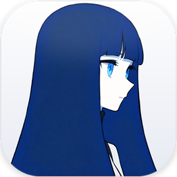
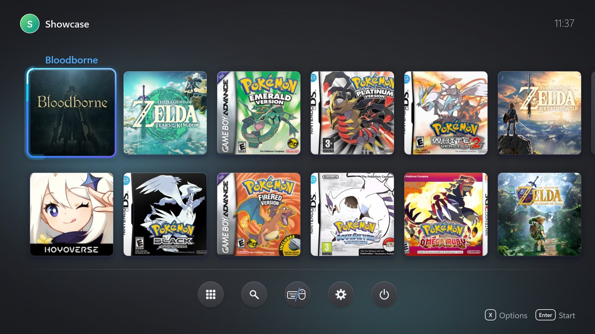
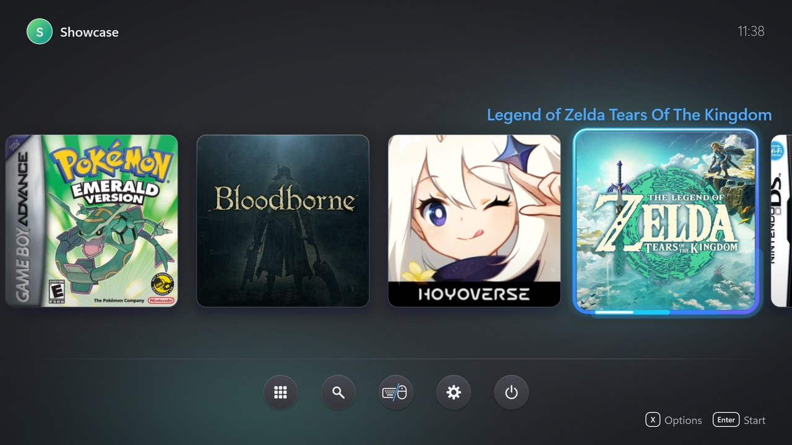
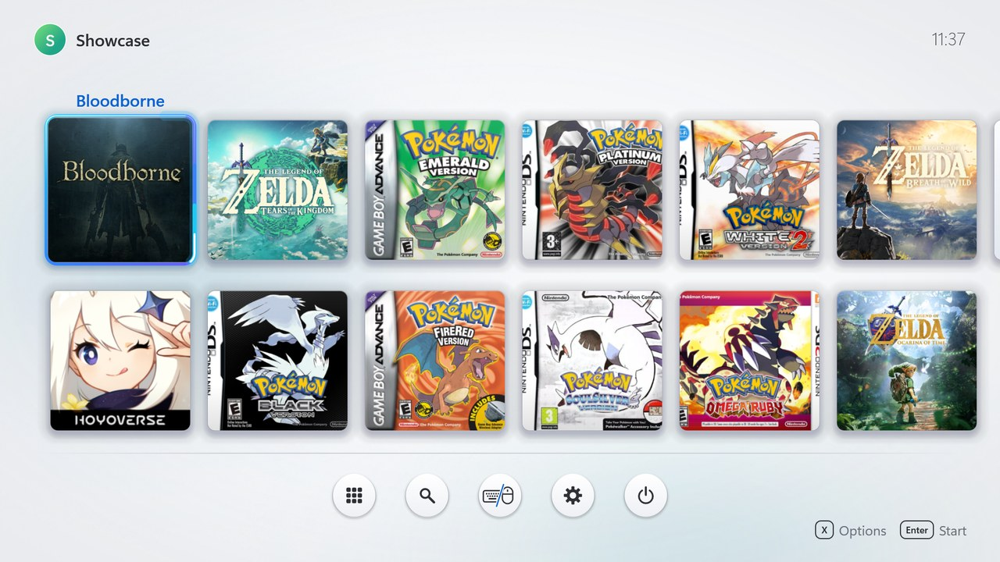
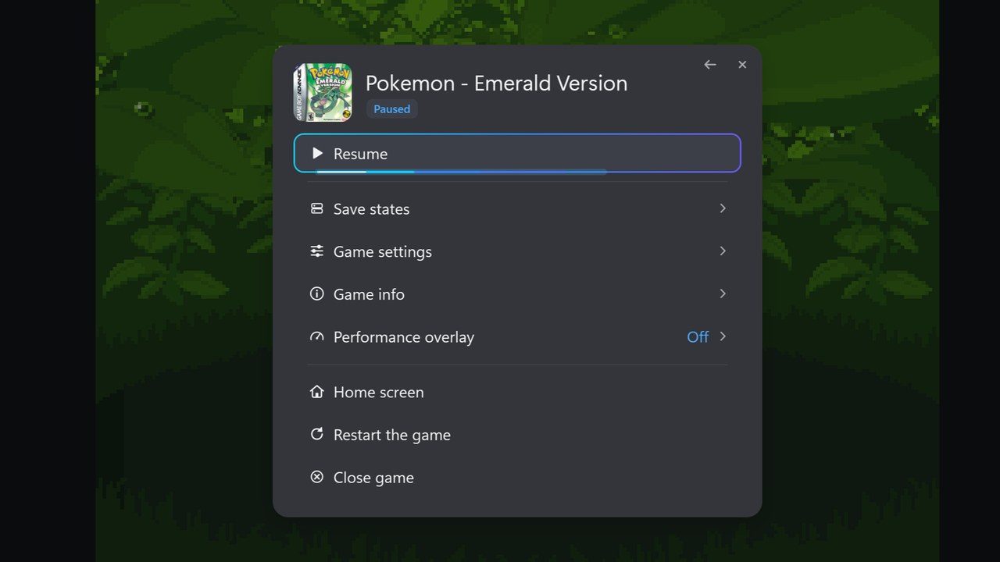
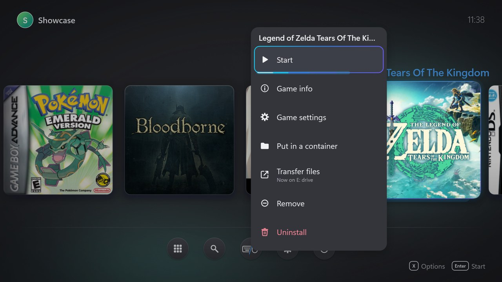
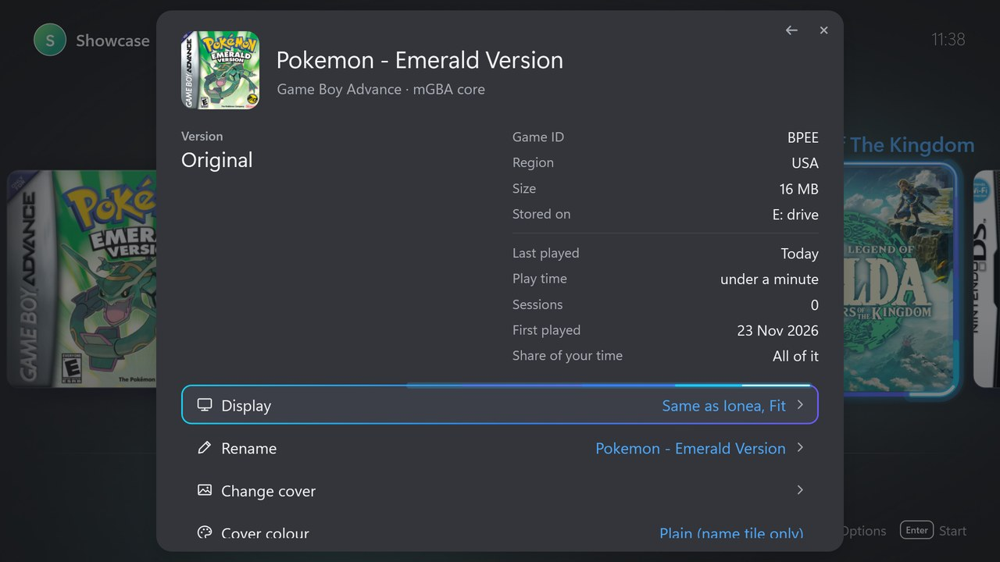
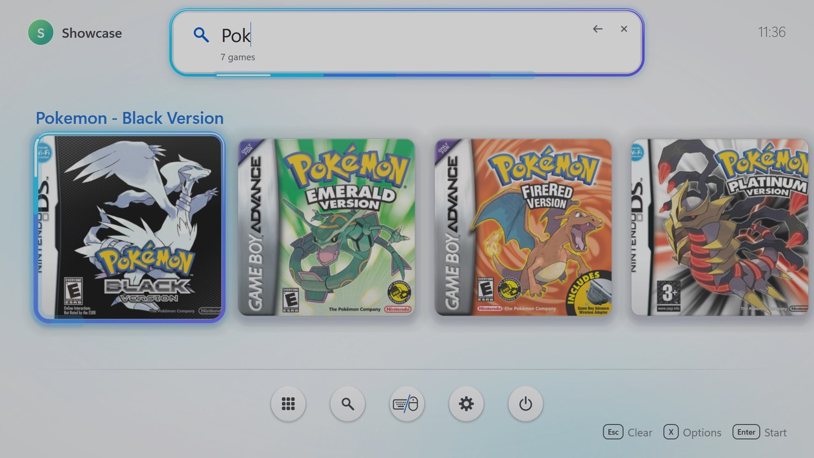
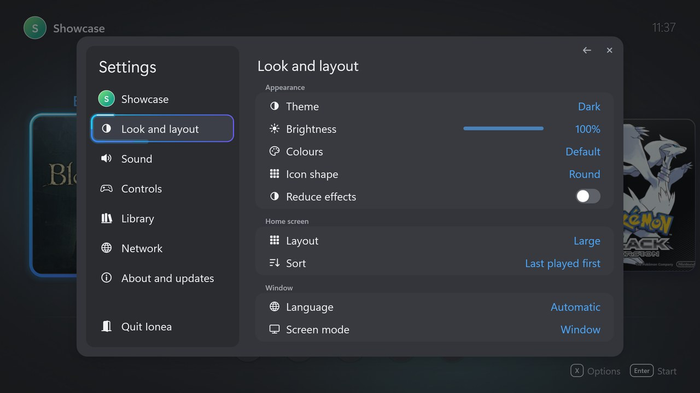
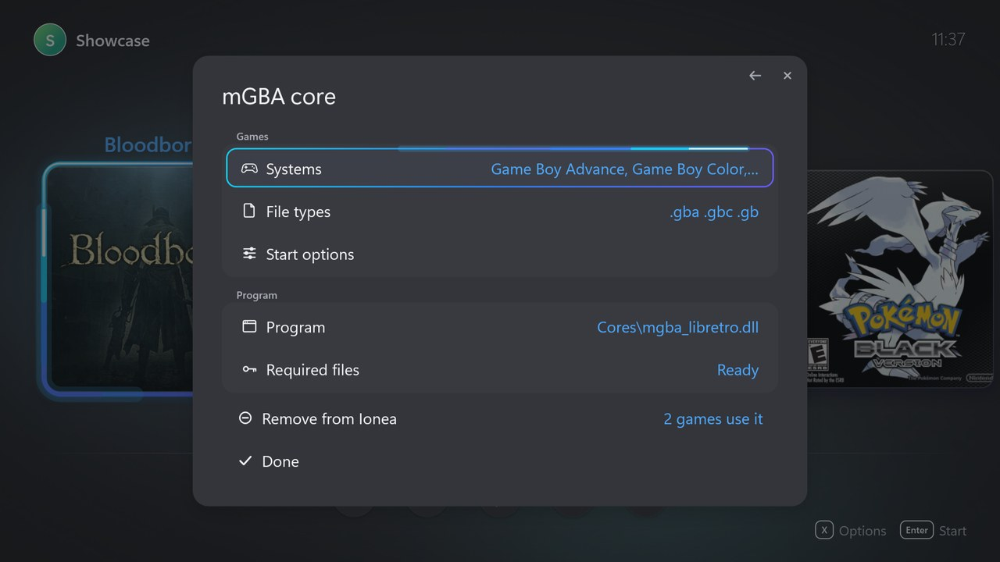

<p align="center">
  
</p>

<h1 align="center">Ionea</h1>

<p align="center">
  A full-screen game launcher for Windows, for the couch and the desk.<br>
  Emulated games, native ports, Steam and PC games on one home screen.
</p>

<p align="center">
  <a href="https://github.com/Kininn/ionea/releases/latest"><b>Download the latest release</b></a>
  &nbsp;&middot;&nbsp;
  <a href="CHANGELOG.md">Changelog</a>
  &nbsp;&middot;&nbsp;
  <a href="LICENSE">MIT License</a>
</p>

<p align="center">
  
</p>

---

Ionea works with a controller as well as with a keyboard and mouse. Many emulators run as libretro cores hosted
inside Ionea itself: Ionea draws the picture, plays the sound, reads the controllers and owns the Home menu, save
states and settings. Standalone emulators work too; their window is placed inside Ionea's and paused from its Home
menu.

> Ionea ships no emulators, cores, BIOS or firmware files, keys or games. You supply your own.

## Install

**Installer:** download `Ionea-<version>-setup.exe` from the [latest release](https://github.com/Kininn/ionea/releases/latest)
and run it. It installs for you only, needs no administrator rights and no .NET, and adds a Start menu shortcut.
The installer is not signed yet, so Windows may say it is from an unknown publisher: choose
**More info > Run anyway**. Installing a newer release over it keeps your data and settings. Uninstall it from Windows' Settings > Apps; it
keeps your data unless you say otherwise.

**Portable:** unpack `Ionea-<version>.zip` into any folder you can write to and start `Launcher.exe`. The data
folder is made next to it, so the whole folder can be moved.

Either way, Ionea can update itself from this page's releases: switch on the network connection in Settings >
Network, then check in Settings > About and updates (or switch on Update notification or Auto update there). Needs Windows 10 or 11 (64-bit), and OpenGL
3.3 or newer for cores that draw with the GPU.

## Features

- A home screen of game tiles with covers, containers (folders), search and a quick menu on a held tile.
- Games played inside the launcher through libretro cores (for example GBA, DS, 3DS, GameCube and Wii cores),
  with save states, core settings, low-latency sound and pacing matched to the display's refresh rate.
- Standalone emulators kept inside Ionea's window and paused from the Home menu. For emulators Ionea knows, the
  controls you set up are written into the emulator's own settings.
- A scan of this PC for emulators and game folders, and an optional download of an emulator's or core's official
  release.
- Emulator and system definitions as JSON files, extendable with your own.
- Required files: which BIOS, firmware or key files each emulator needs; the files you pick are checked and
  copied where they belong.
- Profiles with their own saves, save states and play stats.
- Keyboard, mouse and controller set-up (Xbox, PlayStation, Switch Pro and most other controllers), one player per
  controller, an on-screen keyboard and a file browser that works with a controller.
- Moving games between drives and network shares, with every file checked before the originals are deleted.
- Game info: version, updates, add-ons, region, size and play time; cover choice and adjustment.
- Per-game display, graphics and performance settings, and an in-game performance overlay.
- Optional Discord status, cover downloads and updates from a GitHub release.

## Screenshots

<table>
  <tr>
    <td align="center"><br><sub>Large layout</sub></td>
    <td align="center"><br><sub>Light theme</sub></td>
  </tr>
  <tr>
    <td align="center"><br><sub>The Home menu over a running game</sub></td>
    <td align="center"><br><sub>Hold a tile for its quick menu</sub></td>
  </tr>
  <tr>
    <td align="center"><br><sub>Game info: version, region, size and play time</sub></td>
    <td align="center"><br><sub>Search as you type</sub></td>
  </tr>
  <tr>
    <td align="center"><br><sub>Settings: look and layout</sub></td>
    <td align="center"><br><sub>An emulator: systems, file types, program and required files</sub></td>
  </tr>
</table>

## More

<details>
<summary><b>First start</b></summary>

1. Create a profile: a name and, if you like, a picture.
2. Network: the Network connection switch starts off, so Ionea stays offline until you switch it on. Each kind of
   online use (covers, emulator and core downloads, definition updates) also has its own switch, and all start off. A program (an emulator
   or a core) is only downloaded after you confirm it. Settings > Network > Network activity lists every request.
3. The scan looks for emulators and game folders on this PC. When it finds nothing, it offers to download an
   emulator or a core.
4. Required files: if an emulator needs BIOS, firmware or keys that are not there yet, Ionea lists them. Pick your
   own files; Ionea checks them and copies them into place.
5. Controls: set up your keyboard, mouse or controller.
6. A short tutorial shows how to add an emulator and a game, start it and open the Home menu. Skip it any time and
   watch it later from Settings > About and updates.

</details>

<details>
<summary><b>Controls</b></summary>

The launcher's keys can be changed in Settings > Controls > Launcher keys. The defaults:

| Action | Keyboard | Controller |
|---|---|---|
| Move | Arrow keys or W A S D | D-pad or left stick |
| Select | Enter or Space | A |
| Back | Esc or Backspace | B |
| Game options | X, F2 or Delete | X |
| Settings | F1 or the Menu key | |
| Previous / next page | Page Up / Page Down | |
| Search | Ctrl+F | |
| Home menu, during a game | Alt, tapped alone | Guide, or View + Start |

Hold Select on a game for its quick menu. With the mouse, pointing moves the focus, a left click selects, a right
click goes back and the wheel scrolls.

Game controls (the buttons a game sees) are set per device in Settings > Controls > Game controls. They apply to
games played inside Ionea and to standalone emulators whose settings Ionea manages. Steam and PC games keep their
own controls.

</details>

<details>
<summary><b>Settings</b></summary>

- **Profile**: name, picture, play stats and the profile's own preferences.
- **Look and layout**: theme, brightness, colours, icon shape, reduce effects; home screen layout and sort; full
  screen or window; game display, performance overlay, matching the display and streaming mode (so window capture
  in Discord or OBS sees the game); intro and outro.
- **Sound**: launcher sounds and levels.
- **Controls**: devices, pop-ups when a device connects, launcher keys and game controls.
- **Library**: emulators, storage places, removed games, adding games, looking for emulators, Task Manager grouping.
- **Network**: the network connection (per profile, off by default), the online switches, network activity, a SteamGridDB key and Discord
  status.
- **About and updates**: version, changelog, the tutorial, where updates come from (this repository's releases, built in),
  checking for and installing updates, Update notification and Auto update at launch (both off by default), and
  going back to the previous version.

</details>

<details>
<summary><b>Where data lives</b></summary>

Ionea keeps its data in a `data` folder next to `Launcher.exe`, made on first start: settings, the library,
profiles with their saves and save states, covers, emulators it downloaded, required files and the log. If that
folder can't be written (for example under Program Files), it uses `%LOCALAPPDATA%\Ionea\data` instead.
`--data <folder>` picks another one.

Your own emulator and system definitions go in `data\definitions\` and win over the shipped ones in
`definitions\`. Updates replace only the program, `definitions\`, `LICENSE`, `THIRD-PARTY.md` and `CHANGELOG.md`; the data
folder is never touched.

</details>

<details>
<summary><b>Command-line switches</b></summary>

| Switch | What |
|---|---|
| `--data <folder>` | use another data folder |
| `--windowed`, `--fullscreen`, `--size 1600x900` | how the window starts |
| `--mute` | no launcher sounds |
| `--esde <folder>` | also use an ES-DE folder's games and emulators |

</details>

<details>
<summary><b>Building from source</b></summary>

From source (needs the .NET 10 SDK):

```powershell
powershell -File Install-Launcher.ps1                          # build and install to <system drive>\Ionea\Launcher
powershell -File Install-Launcher.ps1 -Target <folder>         # or into any folder you can write to
```

`Install-Launcher.ps1` adds a desktop shortcut "Ionea" (`-NoShortcut` leaves it out) and keeps the program it replaces as
`Launcher.previous.exe`, so Settings > About and updates can go back to it.

```powershell
dotnet build -c Release                                        # build only
powershell -File Install-Launcher.ps1 -BuildOnly <folder>      # a complete build in a folder, nothing installed
powershell -File tools\Make-Release.ps1                        # a release: portable zip, installer, SHA256SUMS
```

Builds are self-contained (the .NET runtime is inside `Launcher.exe`); `Install-Launcher.ps1 -FrameworkDependent`
makes the smaller exe that needs the .NET 10 Desktop Runtime. The installer is built from `installer\Ionea.iss`
with Inno Setup 6, when it is installed.

</details>

## Licence

Ionea is released under the MIT License; see [LICENSE](LICENSE). The third-party data used in the definitions, the
.NET runtime built into the program, and their licences are listed in [THIRD-PARTY.md](THIRD-PARTY.md). Emulators, cores and other programs you use with
Ionea keep their own licences.
